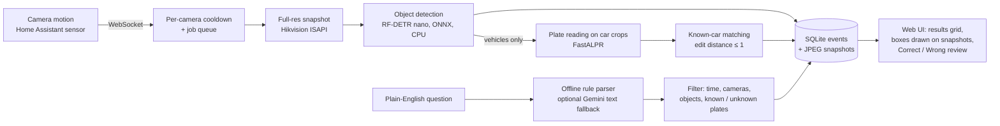

# Ultron Eyes

**Ask your security cameras questions in plain English.** Ultron Eyes watches for motion on a
Hikvision NVR, runs object detection and license plate reading **entirely on your own computer**,
and gives you a search page where you can type things like:

- *"Was anyone at the front door last night?"*
- *"When was Dad's car in the driveway today?"*
- *"Unknown cars this week"*
- *"Dogs in the backyard after 9pm"*

No cloud video service, no subscription, and no camera images ever leave your network.

> Part of **Ultron**, a self-hosted home assistant built on Home Assistant, Matter, and a Nest Hub display.

---

## How it works



1. **Trigger.** Subscribes to Home Assistant's camera motion sensors over the WebSocket API. A
   per-camera cooldown stops one visitor from creating dozens of events.
2. **Capture.** Pulls a full-resolution JPEG straight from the NVR (ISAPI, digest auth, view-only user).
3. **Detect.** Runs RF-DETR (COCO classes: person, car, truck, dog, cat, bicycle, ...) with ONNX Runtime on the CPU.
4. **Read plates.** Only on cameras you enable, and only inside detected vehicle boxes: a plate is a few
   dozen pixels wide in a 2560×1440 driveway frame, so cropping first matters.
5. **Match.** Plates are normalized and compared to your known-cars list with Levenshtein distance ≤ 1,
   so a single misread character still matches the right car.
6. **Store.** SQLite for metadata, JPEG files for snapshots, automatic deletion after `retention_days`.
7. **Search.** A rule-based parser turns questions into filters offline. If it can't understand a question
   and you configured a Gemini key, **only the question text** is sent to Gemini to produce the same filter.

## Privacy by design

| Concern | What Ultron Eyes does |
|---|---|
| Camera images | Processed locally. Never uploaded anywhere. |
| AI search | Offline parser first. Optional Gemini fallback receives question text only. |
| NVR access | Read-only snapshot endpoint, meant for a view-only NVR user. |
| Faces | No face recognition. It only reports "person". |
| Plates | Matched against **your own** known list. Unknown plates stay unknown; no owner lookups. |
| Retention | Snapshots auto-delete after 14 days (configurable). |
| Web UI | Binds to `127.0.0.1` by default; Host-header allowlist blocks DNS rebinding; cross-site POSTs are rejected; a token is required to expose it on the LAN. |
| Secrets | `config.yaml` is git-ignored; credentials can come from environment variables. |
| Shared PC | Runs at below-normal priority; models only run when something moves. |

## Quick start

Requires Python 3.12+ and [uv](https://docs.astral.sh/uv/).

```bash
git clone https://github.com/bilala21/ultron-eyes.git
cd ultron-eyes
cp config.example.yaml config.yaml     # fill in NVR, cameras, Home Assistant token
uv sync
uv run ultron-eyes scan                # snapshot + analyze every camera once
uv run ultron-eyes run                 # listen for motion and serve http://127.0.0.1:8765
```

**Windows (auto-start at logon):**

```powershell
powershell -ExecutionPolicy Bypass -File scripts\install_windows.ps1
# later, to update: powershell -ExecutionPolicy Bypass -File scripts\update_windows.ps1
```

Other commands:

```bash
uv run ultron-eyes analyze photo.jpg --plates   # try the models on any image, no camera needed
uv run ultron-eyes stats                         # events, review accuracy, latency
uv run pytest                                    # tests
```

## What the search understands

| You type | Becomes |
|---|---|
| `last night`, `today`, `yesterday`, `friday`, `this week`, `last 3 hours` | time window |
| `after 9pm`, `before 7am`, `between 2 and 5pm`, `this morning` | time of day |
| `people`, `someone`, `cars`, `vehicles`, `dogs`, `bikes` | object classes |
| `front door`, `driveway` (matches every driveway camera), `cam 3` | cameras |
| a known car's name, like `dad's car` | plate matched to that name |
| `unknown cars`, `cars I don't know` | plates not on the known list |
| `package` | warns that packages aren't a detectable class yet |

## Measuring accuracy

Every result has **Correct / Wrong** buttons. Reviews are stored with the event, and
`ultron-eyes stats` (or the page footer) reports precision on reviewed events and the median and
95th-percentile time from motion to saved event. This keeps accuracy claims honest: they come
from labeled events on real cameras, not from the models' published benchmarks.

Early numbers from development (Apple M1 CPU, 10 cameras, 1920×1088 frames):

| Step | Time |
|---|---|
| Object detection (RF-DETR nano) | ~125 ms per frame |
| Plate reading per vehicle crop | ~10 to 15 ms |
| Motion trigger to saved event (incl. NVR snapshot) | ~1.5 s median |

The NVR snapshot is the slowest step (~1.5 s for a full-resolution JPEG).

## Project layout

```
src/ultron_eyes/
  config.py     YAML + env config, plate normalization
  nvr.py        Hikvision ISAPI snapshot client
  vision.py     RF-DETR object detection, FastALPR plates on vehicle crops, known-car matching
  store.py      SQLite events, snapshots, review, stats, retention
  query.py      plain-English -> filter (offline rules, optional Gemini text fallback)
  pipeline.py   Home Assistant motion listener, cooldowns, worker thread
  web.py        FastAPI JSON API + search page
  static/       single-file web UI
tests/          parser, plate matching, storage, retention
scripts/        Windows installer, macOS dev relay
```

## Limitations and next steps

- One snapshot per motion event, so it can't tell "arriving" from "leaving" yet. Next: a short burst of
  frames and vehicle tracking for direction.
- Plates are only readable when the back of the car faces the camera (many cars have no front plate).
- COCO has no "package" class. A small custom-trained detector would fix that.
- Push alerts for unknown plates through Home Assistant notifications.

## Built with

[RF-DETR](https://github.com/roboflow/rf-detr) and plate models via
[open-image-models](https://github.com/ankandrew/open-image-models) and
[FastALPR](https://github.com/ankandrew/fast-alpr) (MIT), ONNX Runtime, FastAPI, SQLite, Home Assistant.

## License

MIT
